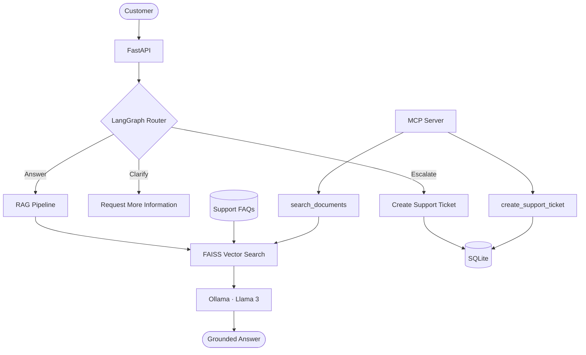

# Support Triage Agent

**AI-powered support automation through RAG, intelligent routing, and tool integration.**

A modular AI system that retrieves relevant knowledge, routes client requests to the appropriate workflow, and automates ticket creation for issues requiring escalation.

**Tech Stack:** Python · LangGraph · LangChain · FAISS · Ollama · FastAPI · MCP · SQLite · Docker
## Architecture



## What makes it interesting?

- **Grounded answers:** Retrieve relevant support policies using Ollama embeddings and FAISS before generating a response with Llama 3.
- **Explicit decision-making:** Use LangGraph to route requests through answering, clarification, or escalation workflows.
- **Actionable tools:** Expose document search and ticket creation through a separate MCP server.
- **Persistent actions:** Store escalated requests in SQLite, with ticket IDs returned to the customer.
- **Testable workflows:** Evaluate routing decisions and log execution to make behavior easier to inspect and debug.

## Tech Stack

`Python` · `LangChain` · `LangGraph` · `FAISS` · `Ollama` · `FastAPI` · `MCP` · `SQLite` · `Docker`

## Validation

The answer, clarification, and escalation workflows have been tested end-to-end through the Dockerized API. Both MCP tools have also been tested using MCP Inspector.

Automated routing tests and application logging provide a foundation for further evaluation of edge cases and retrieval quality.

## Run it locally

**Prerequisites:** Docker Desktop and Ollama, with `llama3:latest` and `nomic-embed-text` available.

```bash
docker compose up --build -d
```

Open the API documentation at **http://localhost:8000/docs** to test the agent.

---

**Lina Hamad** · [Portfolio](https://portfolio-lina-bd56.vercel.app/) · [GitHub](https://github.com/Lina-hamad24) · [LinkedIn](https://www.linkedin.com/in/lina-hamad-/)
