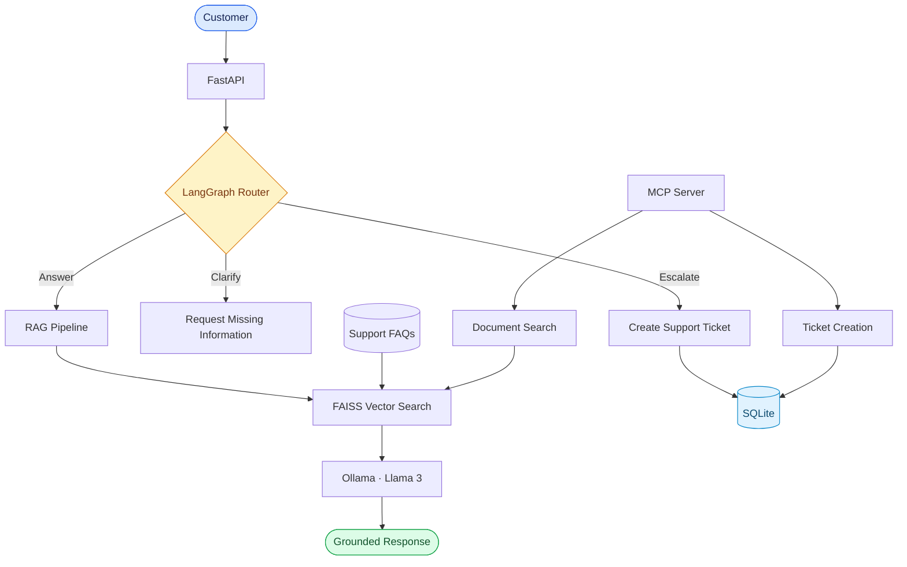

# Support Triage Agent
### AI that knows when to answer, when to ask, and when to act.

Most AI support demos stop at generating a response. This project goes further: it combines retrieval, decision-making, and tool execution in a system designed to handle different customer needs.

## Architecture



## Engineering highlights

- **Grounded generation:** Retrieve relevant policies using Ollama embeddings and FAISS before generating answers with Llama 3.
- **Explicit decision-making:** Orchestrate answer, clarification, and escalation paths with LangGraph.
- **Actionable tools:** Expose document search and ticket creation through a separate MCP server.
- **Persistent state:** Record escalated requests in SQLite instead of returning a response and stopping there.
- **Testable behavior:** Evaluate routing decisions against predefined cases and log execution for debugging.
- **Containerized deployment:** Serve the application through FastAPI and Docker Compose, with Ollama running locally.

## Built with

`Python` · `LangGraph` · `LangChain` · `FAISS` · `Ollama` · `FastAPI` · `MCP` · `SQLite` · `Docker`

## Results

**6/6 routing test cases passed** in the current evaluation suite.

The application has been tested through its Dockerized API, including the answer, clarification, and escalation paths. Both MCP tools have also been tested using MCP Inspector.

## Run it

Prerequisites: Docker Desktop, Ollama, and the `llama3:latest` and `nomic-embed-text` models.

```bash
docker compose up --build -d
```

**[Explore the API](http://localhost:8000/docs)** · [View source code](https://github.com/Lina-hamad24/support-triage-agent)

---

**Lina Hamad** · [Portfolio](https://portfolio-lina-bd56.vercel.app/) · [GitHub](https://github.com/Lina-hamad24) · [LinkedIn](https://www.linkedin.com/in/lina-hamad-/)